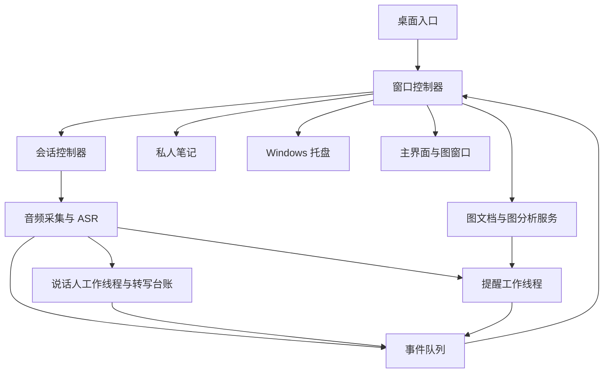

# Sentinel 架构导读与优化路线

初始审查日期：2026-11-17，基于提交 `2e86b121626aa9b91e681fcbff4355fc2ae5756f`。
本文记录当前代码结构、已完成的优化和后续路线，避免后续开发依赖聊天历史。批次 A、B 已在工作区完成；后续目标结构尚未实现。

## 当前系统

Sentinel 是 Windows 桌面应用（Tk 主工作区 / Qt 会议浮窗），使用本地 Paraformer 做流式转写、CAM++ / VAD 做说话人区分，通过用户配置的兼容 API 生成提醒和对话逻辑图。私人笔记使用独立本地存储。

| 入口 / 模块 | 当前职责 | 修改时优先阅读 |
| --- | --- | --- |
| `sentinel_app.pyw` | 桌面启动、单实例、运行日志、顶层异常 | `sentinel_paths.py`、`sentinel_panel.py` |
| `sentinel_live.py` | CLI 参数、音频采集与解码、转写分发、会话日志与指标、资源收尾 | `test_desktop.py::RunLifecycleTests` |
| `sentinel_audio.py` | 麦克风能力预检、采样率适配、固定本次输入设备、采集流错误提示；不依赖 GUI、ASR 或 API | `test_audio.py`、`test_desktop.py::RunLifecycleTests` |
| `sentinel_session.py` | 单个会话线程、开始 / 停止 / 命令、末尾事件消费后的回收；不依赖 Tk、音频库和 SDK | `test_session.py` |
| `sentinel_panel.py` | 界面控制、API / 声纹设置、图服务管理、事件消费、退出协调；使用独立会话控制器 | `test_desktop.py`、`test_desktop_features.py` |
| `sentinel_ui.py` | 提醒主页、常显上下文、转写与准备页的布局和刷新 | `sentinel_panel.py`、`UI_UPDATE.md` |
| `sentinel_overlay_ui.py` | 惰性创建 Qt 窗口；Tk after 事件桥接、可见性与销毁；不管理音频 | `test_desktop_features.py` |
| `sentinel_meeting_window.py` / `sentinel_meeting_icons.py` | 逐像素透明横条、矢量图标、同窗展开及原生窗口行为 | `sentinel_panel.py`、`UI_UPDATE.md` |
| `sentinel_meeting_content.py` | 共享转写 / briefing 展示与原话依据；没有自己的业务模型 | `sentinel_briefing.py` |
| `sentinel_meeting_graph.py` | 同一个 GraphDocument 的 Qt 渲染、关系依据、状态和重试入口 | `sentinel_logic.py`、`sentinel_graph_layout.py` |
| `sentinel_meeting_material.py` | 横条、面板与图卡共享的玻璃填充、高光及外阴影，不管理原生窗口 | `sentinel_meeting_window.py`、`sentinel_meeting_graph.py` |
| `sentinel_glass.py` | Qt HWND 低染色白色 acrylic，失败后普通 blur 回退；不建辅助窗口，不调全窗 alpha | `sentinel_meeting_window.py` |
| `sentinel_workspace.py` | 单窗口工具页面、离页保存、隐藏输入焦点、沉浸工具布局 | `test_desktop_features.py` |
| `sentinel_scroll.py` | 溢出才显示的细滚动滑块、Canvas 范围内的滚轮路由与触控板增量 | `test_scroll.py` |
| `sentinel_briefing.py` | 纯事件摘要模型、确认转写引文校验、更正后结论失效 | `test_briefing.py` |
| `sentinel_knowledge.py` / `sentinel_knowledge_ui.py` | 知识库目录选择元数据与内嵌管理页，不含检索 | `test_knowledge.py` |
| `sentinel_theme.py` / `sentinel_window_effects.py` | 共享浅色主题 / 可选圆角和半透明窗口效果 | `test_desktop_features.py`、`UI_UPDATE.md` |
| `sentinel_speakers.py` | 声纹模型、说话人时间线、角色绑定、转写台账、音频工作线程 | `test_speakers.py` |
| `sentinel_observer.py` | 通用客户端创建、JSON 解析、提醒提示词、请求调度、去重、关闭 | `test_observer.py`、`test_desktop.py::ShutdownTests` |
| `sentinel_logic.py` | 图文档、证据校验、更正失效、保存加载、图分析工作线程 | `test_logic_graph.py` |
| `sentinel_logic_ui.py` | 全局图渲染、缩放平移、历史图入口、证据查看 | `test_logic_graph.py::ViewTests` |
| `sentinel_graph_layout.py` | 无 Tk 的分层分支布局、汇合与循环关系处理 | `test_logic_graph.py` |
| `sentinel_desktop.py` / `sentinel_notes_ui.py` | 桌面偏好、私人笔记存储 / 编辑器 | `test_desktop_features.py` |
| `sentinel_config.py` / `sentinel_paths.py` | API 配置、DPAPI、开发配置、资源和用户数据路径 | `test_packaging.py` |
| `sentinel_windows.py` | Windows 托盘、消息循环、单实例、原生注册封装 | `test_native_windows.py` |
| `restore_models.py` / `download_release_assets.py` / `packaging/` | 模型恢复、发行附件下载、构建安装 | 对应恢复、下载、打包测试 |

图中的 `Graph → Observer` 是共享客户端 / JSON 辅助函数的依赖，并非图分析调用提醒分析。UI 文件还会访问 Panel 对象的方法和内部属性；导入图不能完整呈现这种耦合。

### 需要保留的行为边界

- 待机不打开麦克风、不加载识别模型、不发起分析；模型加载与网络请求不阻塞 Tk 主线程。
- 麦克风回调向有界队列投递；提醒只保留最新待分析快照，避免无限积压。
- 停止后先关闭采集，再等待后台工作结束；迟到结果不应进入下一会话。
- 转写台账和主界面仅保留最近 128 段工作数据；图文档在内存中收集本场完整已确认片段，启动图服务后负责落盘。两者的保留范围不能在拆分时混淆。
- 逻辑图的引文必须来自真实片段；角色或原文更正后，相关结论失效；未知说话人不由模型猜阵营。
- 私人笔记不进入转写或分析请求；原始音频保存需要显式同意并受时长限制。
- 模型与程序资源和用户可写数据分离；安装版不读取开发目录 `.env`。

## 已验证的问题与优化顺序

### 1. 先建立可复现的测试基线

两个问题在初次体检的完整测试及排除 Tk 测试后的复测中均出现，现已在批次 A 修复：

- 原 `test_packaging.py::test_developer_env_is_read_but_never_written` 直接读取项目根目录 `.env`，干净克隆报 `FileNotFoundError`。现使用临时假配置并替换 `config.SOURCE_ROOT`，真实调用 dotenv，验证读取内容且文件字节保持不变。
- 原 `sentinel_live.py::run` 仅用墙上时钟字符串生成日志路径，再以 `open(..., 'x')` 创建。连续会话时两次时钟读数相同，报 `FileExistsError`。现保留可读时间并追加 UUID；回归测试固定时钟，验证两份独立日志均含会话开始与总结。

这两项已通过目标测试与完整回归，避免后续结构调整掩盖已有失败。

### 2. 把后台生命周期从窗口中抽出

批次 B 已将 `SessionController` 从 `sentinel_panel.py` 原样迁至 `sentinel_session.py`；Panel 仍在模块顶层导入它，原导入路径保持兼容。`SentinelPanel.start()`、`handle()`、`poll()` 仍同时处理业务状态、图服务替换、线程退出条件和控件展示，属于下一批的范围。

例如退出时必须先消费 ASR 最后一个确认片段，再停止图分析并等待图文件保存。这条业务规则目前依赖窗口轮询顺序，改变 UI 调度也可能改变数据收尾。

第一步的模块迁移和无 Tk 生命周期验证已完成。第二步提取应用服务协调器，统一管理监听、图服务及退出；窗口通过操作方法和展示状态与其交互。继续保持线程行为、事件字段和目录布局的独立变更边界。

验收：无需 Tk 的测试覆盖重复开始、加载中停止、停止后重启、工作线程异常、退出末句保存、旧结果隔离。

### 3. 为视图建立明确接口

`sentinel_ui.py` 的 `build_view(p, ...)` 在传入的 Panel 上动态创建控件；`refresh_view()` 又读取 `p.controller.stop_event`。逻辑图窗口的 `retry()` 直接调用 Panel 并访问其服务对象。

这不是 Python 导入循环，但存在对象层面的双向依赖：理解一个视图函数，需要知道另一文件创建了哪些属性、线程状态和回调。

建议先让构建函数返回明确的视图对象，集中持有控件；刷新只接收展示状态，按钮通过显式回调提交操作。逐个窗口迁移，不一次引入通用 UI 框架。

验收：现有布局与交互测试继续通过；同一会话切换详情、悬浮卡片、迷你条和托盘时，后台身份与麦克风状态保持一致。

### 4. 分离逻辑图规则、持久化和分析

`sentinel_logic.py:49` 的 `GraphDocument` 同时拥有证据规则、修订状态、文件路径及保存加载；187 行的 `GraphWorker` 又负责调度、提示词、SDK、重试和落盘。通用客户端仍从提醒功能模块导入。

建议按顺序提取：共享 LLM 客户端 / 响应辅助函数 → 图分析服务 → 图文件存储。证据校验和更正失效规则保留在文档模型中。提醒与图分析仍保留各自调度策略，不强行合并为一个工作线程框架。

验收：伪造引文拒绝、补丁原子性、角色更正使旧判断失效、长会话批次追赶、停止丢弃在途结果、历史图只读等已有行为不变。

### 5. 让配置和事件成为可见契约

`sentinel_config.py:59` 将已保存配置写入全局 `os.environ`；提醒和图分析在不同时间创建客户端。配置选择与生效时机因此依赖调用顺序，测试也大量修改进程环境。

建议先定义配置读取优先级和“新会话生效”的规则，再让配置加载返回明确的值，并在会话创建时传入服务。环境变量保留为输入源。事件仍可使用字典，但应先为 `final`、`attribution_update`、`stopped` 等关键消息集中定义字段、来源、时钟和会话标识；无需引入事件总线依赖。

验收：配置优先级、安装版配置隔离、会话中修改配置后的生效时机、跨会话事件归属均有独立测试。

## 分批实施与结构目标

| 批次 | 改动范围 | 交付和回滚边界 |
| --- | --- | --- |
| A · 已完成 | 假配置测试、日志唯一命名 | 固定时钟回归通过；消除两处已复现错误 |
| B · 已完成 | `SessionController` 独立模块 | 保持现有导入兼容；新增 7 项无 Tk 生命周期测试 |
| C | 应用服务协调、退出顺序、关键事件契约 | UI 仅调用业务操作；独立验证收尾和重启 |
| D | 显式视图对象与回调 | 每次只迁移一个窗口 |
| E | 通用 LLM 客户端、图分析与图存储分离 | 保持持久化格式和证据规则；逐项提交 |

先通过职责和接口降低耦合。待上述边界稳定，再考虑迁入 `sentinel/` 包并按 `runtime`、`desktop`、`speakers`、`logic` 组织功能；单纯移动文件不作为优化成果。迁包时同步更新入口、PyInstaller、安装脚本和测试发现路径。

每批由另一上下文独立审查，检查依赖方向、异常清理、数据完整性与行为兼容；避免全局服务定位器、循环依赖和仅转发调用的空壳抽象。

## 初次体检验证记录与限制

- 新克隆；Python 3.12.14；项目内独立 `.venv`，按 `requirements.txt` 安装依赖。安装的是当前可获取版本，例如 `openai==3.52.0`，不是发行锁定的 `3.46.0`，所以结果不代表原发行环境复现。
- 完整发现并运行 97 项：73 通过、22 错误、2 跳过。其中 20 错误来自本机 Tcl 初始化失败，另外 2 错误为上述 `.env` 缺失与日志路径冲突。
- 排除 20 项需 Tk 的测试后，复测 77 项：73 通过、2 错误、2 跳过；两项代码 / 测试问题再次出现。
- 2 项跳过为需显式启用的原生 Windows 测试。没有运行真实麦克风、付费 API、模型推理或安装包验收；没有下载运行模型。
- 测试运行设置了隔离的 `SENTINEL_DATA_DIR`。本轮不修改业务代码；运行记录和审查辅助脚本位于已忽略的 `.downloads/`。
- 另一个 Agent 已独立完成只读架构审查，确认 UI 隐式对象契约、生命周期分散、图模块职责混合与配置全局状态问题。

后续每批完成后更新本文中已改变的模块归属和验证记录；环境恢复步骤仍以 `DEVELOPMENT.md` 为入口。

## 批次 A、B 验证（2026-11-17）

- 18 项目标测试通过：新会话控制器测试、现有会话运行生命周期测试、配置 / 打包约束测试。
- 完整回归在沙箱外使用同一 Python 3.12 虚拟环境和明确的 Tcl / Tk 库路径运行：104 项，102 通过，2 项原生 Windows 测试按配置跳过。此前的 20 处 Tcl 初始化错误在这次运行中未出现。
- 使用隔离的 `SENTINEL_DATA_DIR`；测试不打开真实麦克风、不调用付费 API。没有重建安装包或进行模型推理验收。
- 7 项新增测试覆盖重复启动、停止等待、末尾事件消费门槛、重启时的参数 / 命令队列 / 停止信号隔离、工作线程异常、线程启动失败与可选依赖不可用时的独立运行。
- 独立 Agent 审查通过；AST 比较确认控制器迁移前后逻辑一致。新模块可经 `sentinel_panel` 的静态导入被 PyInstaller 发现；完整安装包收集和运行仍待构建验收。
- 本轮运行日志为 `.downloads/optimization-tests.txt`（本地忽略文件）；本节为当时分批优化的历史记录，当前同步验收见文末。

## UI 外观调整（2026-11-17）

本批按用户新需求优先调整橙白浅色、半透明悬浮窗与笔记 / 图窗口配色，未继续进行后台服务协调器重构。视觉常量和原生窗口效果独立成模块；`sentinel_ui` 保留原颜色 / `apply_chrome` 导入兼容。半透明仅影响悬浮视图，详情页不透明；不使用原生亚克力背景模糊或透明色鼠标穿透。使用方法和实际预览见 `UI_UPDATE.md`。

完整回归 105 项：103 通过、2 项原生 Windows 测试按配置跳过；日志为 `.downloads/ui-tests-verified.txt`。新增透明偏好 / 视图切换测试通过，独立审查确认紧凑窗口边界和浅色小字对比度问题已修正。本批没有重建安装包。

## 对话工作台与单窗口导航（2026-11-17）

默认 `compact` 提醒主页；`detail` 为独立转写视图，兼容保留 `bar`。桌宠模块及尺寸资源已删除。主页左侧提醒，右侧常显背景、当前、下一步目标。目标、场景、声纹和知识库入口集中到本场准备；监听控制始终可见。所有视图共用单个 SessionController。工具由 `WorkspacePages` 管理内嵌 Frame；`PageContent.deiconify/withdraw/state` 是渲染器的最小适配，不拥有原生窗口。新增工具通过 `panel.open_page` 创建，不使用 Toplevel；系统文件选择器例外。

私人笔记的 `before_leave` 保存失败会取消导航。隐藏页时释放该页后代控件焦点。显式退出仍由 panel 协调后台收尾，页面不拥有音频或网络服务。桌面偏好格式升级为 v2：旧 v1 默认置顶迁移为关闭；v2 保留手动选择。

Observer 的待分析快照独立携带 confirmed_text 与 source_epoch。live 在原文/角色更正发出前调用 invalidate_context；observer 在同一锁下丢弃旧来源响应，panel 再过滤已经进入 UI 队列的旧事件。request revision 只表示请求次序，不能替代更正来源版本。ConversationBrief 的引文匹配不等于模型语义正确，视图必须继续标明 AI 归纳待核对。

知识库登记只保存路径和选择状态，实际分析不消费文档。本轮没有添加检索依赖。窗口尺寸按 DPI 缩放，字体由 Tk 的点字号处理。背景和下一步目标各自要求确认转写引文；缺失时显示等待。下一步目标是 AI 建议结果，不代表已达成；`action` 是具体回应建议。

关闭和收起都调用 `hide_window`，不停止监听；无托盘时最小化到任务栏。提醒只更新正文、导航和托盘未读状态，不改变焦点或可见性。新提醒将提醒正文归顶。更正和新会话清空此前提醒与上下文；此前提醒不标为未解决。

## 逻辑图画布与滚动组件（2026-11-17）

逻辑图使用 `open_page(..., immersive=True)`，导航和监听控制始终保留。主页、转写和工具页 alpha=1，避免桌面文字干扰阅读；仅兼容精简条保留透明偏好。原话依据为画布内按需抽屉，默认折叠；历史加载异常必须展开可见反馈。图没有角色泳道、议题过滤或分页；所有节点位于同一个画布，按依赖纵向推进并允许分支汇合。纯布局处理循环关系，不丢节点。`action` 强制为 inferred；图服务仍只在用户打开逻辑图后启用。

共享 `sentinel_scroll.attach_scrollbars` 直接在 Text / Canvas 内叠放细滑块，不占布局列宽。内容自己拥有 xview/yview；滑块只消费 Tk 的 first/last 分数。轨道点击后的同一次拖拽从目标分数继续，不能依赖尚未触发的 idle 回调。CanvasWheel 使用窗口内绑定和最近祖先 Canvas 路由，覆盖 create_window 中的正文子控件；跳过 Text/Combobox 等原生输入行为，按轴累积触控板小增量。组件销毁时解除绑定，不使用 bind_all，不增加外部依赖。

本轮验证以 UI_UPDATE.md 为准，旧批次日志只作历史记录。独立审查与实现分开，发现的任务栏恢复标记、原话入口、固定转写导航和新提醒归顶问题均加入回归。实际预览使用隔离固定样例，不接音频或 API；未重建发行包。

## 当前会议浮窗边界（2026-11-18）

本节替代早期批次的半透明 / Tk 磨砂实现描述。Tk/GDI 的透明色键和整体 alpha 无法同时满足背景模糊、文字清晰和可靠命中，因此只将会议展示层迁移到 Qt，删除旧 Tk 会议控件和辅助合成策略。业务与工作线程保持原所有权。

- 主窗口 / 主工作区继续使用 Tk。会议模式只显示一个 Qt Window，Tk root withdrawn；回主页隐藏 Qt 后恢复原 Tk root。工具不新增 Toplevel。
- `MeetingOverlay` 惰性创建 QApplication，不执行 app.exec；Tk after 每 16ms processEvents，同一 UI 线程更新两套控件。Qt 原生按钮/菜单/关闭只向桥接队列投递动作，由后续 Tk tick 执行，不能直接调用 Tcl（原生鼠标可触发 GIL 崩溃）；纯 Qt 的拖动、绘制和纯数据证据查看不入队。动作异常用 finally 继续重排 timer。根窗口销毁清空队列、取消 timer 并处理 DeferredDelete。
- Qt 仅消费 Panel 的 `turns`、`turn_view_revision`、`source_epoch`、`briefing`、`logic_document` 与真实监听状态。没有第二个 SessionController 或 GraphWorker；开始分析仍需用户打开图。
- `set_phase` 记录实际麦克风开始时刻，浮窗隐藏不影响计时。`window_visible()` 区分 Qt 可见 / 最小化和 Tk withdrawn，通知与未读不能用 root.state 单独判断。
- 图布局与待归纳原话投影是无 UI 的 `sentinel_graph_layout`；Tk 和 Qt 共用布局与 GraphDocument 的证据规则。图状态独立于 revision 刷新，更正 / 换场后清空旧依据。
- 会议图的相机由 `MeetingGraph` 管理：带父对象的 singleShot QTimer 在真实 viewport 布局后计算视野，列数依据 view 外框宽而非滚动条变化，避免 resize 循环。默认 100% 顶部阅读；全图用实际 item 边界且无 80% 下限；手动缩放在同一文档 revision 更新后保持。逻辑图独立展开尺寸默认 760×440，提醒 / 转录仍 600×300，切换各自保存，屏幕边界由 MeetingWindow 统一限制。
- 只在显式进入或恢复时 show / activate。通知仅更新数据；无托盘时最小化可见表面以保留任务栏入口。
- 按最新玻璃参考，优先低染色白色 acrylic、失败后普通 blur，再降级为可读面板。共享材质模块绘制乳白透明渐变、单根白色高光和柔软外阴影；没有金属内倒角、双层边框或整体 opacity。顶部条与下方面板属于同一 HWND 的两个圆角区域，mask 使间隙透出桌面。默认收起 600×58（玻璃条高 42），提醒 / 转录展开 600×300，逻辑图独立展开 760×440。
- 横条与面板的 `assets/meeting-glass` 已换为用户提供的中性白空白生图，不含旧裁图的景色与染色。JPG 白底输入只能近似重建 Alpha；主体 Alpha 86、四角透明，所有浓度档位保留素材透明度。`sentinel_meeting_material` 缓存 QImage、48px 源角区九宫格伸缩，缺图回退矢量材质；真实控件独立绘制，资产跟随现有 spec 的 assets 目录打包。实时模糊仍由原生合成负责，提取过程见目录 README，Pillow/numpy 只用于开发脚本。
- 右侧上下文是一个 QScrollArea 内的 PlainText QLabel，正文按内容高度换行，只有外层溢出才滚动。原话依据加入同一内容流。转录用 QTextBrowser 分层显示时间/角色和正文，动态文本必须 escape，禁止链接。

验证：本轮完整 167 项（165 通过、2 项可选原生测试跳过），日志 `.downloads/compact-glass-full-tests.txt`。独立只读复核和真实鼠标展开验收已进行；覆盖动作异常后继续操作、销毁取消动作、600px宽长文及原话依据展开。不重建安装包；未验收混合 DPI 或真人声纹准确率。Qt 新依赖与旧离线附件的差异见 DEVELOPMENT.md。

最近展示调整：47 项桌面回归通过，日志 `.downloads/clean-glass-tests.txt`；独立复核和真实鼠标展开验收完成。最后的完整当前概况与依据更正调整通过 2 项针对性回归；此前完整 167 项记录保留。

## 麦克风接入（2026-11-20）

真实入口为 `start_sentinel.cmd` → `sentinel_app.pyw` → `run_panel(args, sentinel_live.run)`；固定数据 UI 预览不接入语音。主页与 Qt 浮窗的开始 / 停止共用同一个 SessionController。

`sentinel_audio.prepare_microphone` 在会话工作线程中先检查输入通道、解析并固定设备索引、校验采样率，再允许加载 ASR、声纹和 LLM。实际采样率随采集数据进入现有解码与声纹时间线。设备检查只查询能力；`--check-audio` 与设置页检查均不打开录音流。设置页用独立线程查询、通过 desktop_events 回主线程更新，退出时等待查询收尾。

`microphone_stream` 分开处理打开 / 启动错误与下游业务错误；构造成功但启动失败也必须 close，成功启动由 ExitStack 收尾。只有采集流成功启动才发 listening；断开且流不再 active 时结束会话。未启动采集的失败不能覆盖 last-transcript.txt。所有错误仍保留原有日志、fatal、stopped 与可再次开始的生命周期；不新增音频线程或 SDK 依赖。

验证：80 项音频 / 桌面 / 会话回归通过（`.downloads/audio-regression.txt`）；启动失败释放修复后的 50 项音频 / 生命周期 / 声纹 / 提醒检查通过（`.downloads/audio-final-tests.txt`）。独立审查已完成，发现的启动失败句柄泄漏已修复并补回归。本机实际设备查询为空；本次使用模拟音频，未恢复模型、未真人识别或调用外部 API，未重建安装包。换机恢复步骤见 README / DEVELOPMENT。

随后实际验收：正式程序的原生鼠标开始操作正确返回无输入设备，未进入假监听；从官方库恢复的三项 ASR 资源通过既有清单 SHA256 校验，使用两段官方 WAV 实际跑通正式 run 的流式识别、转写确认与日志。仅替换采集硬件，未 mock 识别器；无音频丢块或 API 请求。未恢复声纹权重，仍无真实麦克风拾音验收。样例长度、原始识别结果及边界见 `docs/SPEECH_VERIFICATION.md`。

上传前完整回归（2026-11-20）：`python -X utf8 -m unittest discover -v` 共 183 项，181 项通过、2 项需显式启用的原生测试跳过；日志 `.downloads/github-sync-tests.txt`。本次同步范围为源码、测试、界面素材与维护文档；不包含用户配置、运行模型、本地 QA 数据或新安装包。
