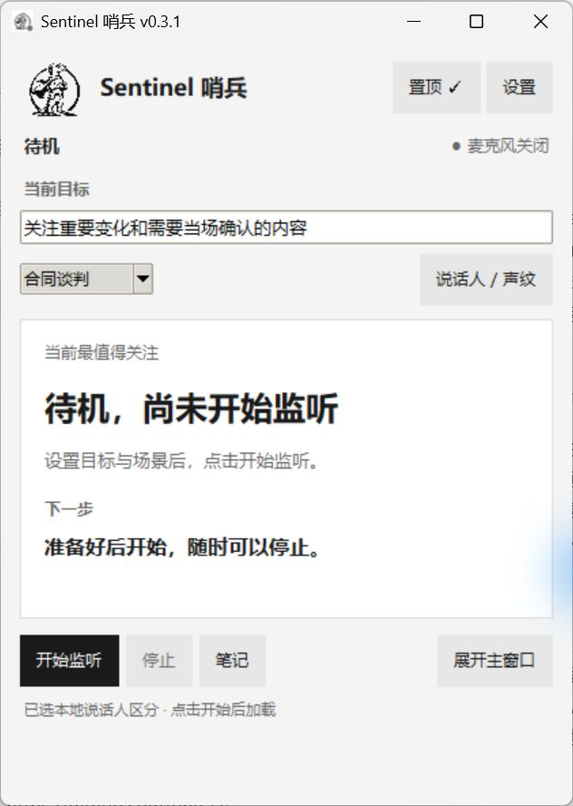

> 更新说明：本文为前一版桌面交互记录。最新版本已取消全局快捷键，采用深色悬浮卡片、迷你状态条和醒目主界面，当前用法见 [UI_UPDATE.md](UI_UPDATE.md)。

# Sentinel 哨兵 v0.3.1 桌面交互交付

在 `D:\Sentinel-ASR-Live-Test\Sentinel-ASR-Live-Test` 上增量修改。Tkinter 仍调用原有 `sentinel_live.run` 和 `SessionController`；`sentinel_live.py`、`sentinel_speakers.py`、`sentinel_observer.py`、`.env`、ASR/CAM++/VAD 模型与 DeepSeek 提醒策略均未改动。

## Windows 使用

双击 `start_sentinel.cmd`。默认紧凑、置顶、待机，麦克风关闭。标题和图标使用提供的 Sentinel / 哨兵 logo；可拖动品牌标题区域，也可以用原生标题栏移动或拖动窗口边缘调整大小。

- 开始前编辑「当前目标」并选择场景，目标最多250字；开始后锁定，停止后可重新编辑。目标直接传给原有 LLM 后端。
- 「展开主窗口」显示转写、原始会话日志位置与详细运行状态；再次点击收起。折叠为状态条后仍保留状态、麦克风状态和快捷操作。
- 「置顶」切换固定置顶并保存在 `desktop_settings.json`；每次启动仍默认紧凑模式。
- 「说话人 / 声纹」保留已有录入、重录、删除、角色绑定和人工纠正功能；紧凑窗显示当前 Speaker ID。
- **关闭 X = 收起到系统托盘，监听继续。**托盘左键恢复，右键菜单可显示、写笔记、开始/停止、退出。设置中也有明确退出按钮。
- 麦克风开启时主窗口显示红色「麦克风开启」，托盘 logo 带红点，提示文字和菜单写明开启；停止请求发出后，在后端确认收尾前保守保留开启状态。Windows 可能把托盘图标收入折叠区，需点系统托盘展开箭头查看。
- 托盘不可用时不会隐藏成找不到的后台程序，而是保留任务栏入口并提示错误。
- 同一项目重复双击启动文件会请求恢复现有窗口，不创建第二个桌面会话控制器。已有命令行测试入口保持独立。

桌面快捷方式：双击 `create_desktop_shortcut.cmd`，创建 `Sentinel.lnk`。目标为本项目 `.venv\Scripts\pythonw.exe`，参数为本项目 `sentinel_app.pyw`，工作目录为项目目录，使用配套 ICO。不创建开机自启项。

## 全局快捷键

| 默认组合 | 操作 |
|---|---|
| Ctrl+Alt+Shift+Space | 显示 / 隐藏主窗口 |
| Ctrl+Alt+Shift+N | 呼出私人快速笔记并聚焦输入 |
| Ctrl+Alt+Shift+L | 开始 / 停止当前监听 |
| Ctrl+Alt+Shift+M | 折叠为状态条 / 恢复之前布局 |

通过「设置」自定义并应用。支持 Ctrl/Alt/Shift/Win 配合字母、数字、Space、F1–F24及常用导航键；F12 保留给系统调试器。至少包含 Ctrl、Alt 或 Win，避免拦截普通输入；同一组合不能绑定两项。

使用 [Windows RegisterHotKey](https://learn.microsoft.com/en-us/windows/win32/api/winuser/nf-winuser-registerhotkey)，带 MOD_NOREPEAT；没有安装全局键盘记录钩子。注册失败会显示组合与原因，不终止 ASR。首次启动尽量保留无冲突的绑定；修改已有绑定发生冲突时尝试恢复原绑定，成功后才持久化新设置。设置中显示实际生效组合，失败项不会被伪装成成功。

独立 Windows 消息线程通过事件队列通知 Tk 主线程，不从热键/托盘回调操作 Tk。系统托盘通过 [Shell_NotifyIconW](https://learn.microsoft.com/en-us/windows/win32/api/shellapi/nf-shellapi-shell_notifyiconw) 创建，显式退出时移除图标并注销全部已注册热键。应用不改 Windows 全局代理、权限或开机启动设置。

## 私人笔记

三个类型：「我在想」「我想知道」「我想说」。支持不完整句子、换行、长文本，Ctrl+Enter 或「保存并新建」保存。

- 保存到 `private_notes/notes.jsonl`，字段包含 `note_id`、`note_kind`、原始 `text`、`created_at`、`session_id`、`asr_log` 和 `draft`。
- 明确标记 `source=private_keyboard_input`、`spoken=false`、`send_to_llm=false`，从不插入 ASR 的 final/partial，也不进入 observer.submit。
- 桌面点击开始时生成稳定场次 ID。`private_notes/sessions.jsonl` 把此 ID 关联到后端实际 JSONL 路径，因此不会改动已有 ASR 日志格式。待机笔记有独立 standby 场次。
- 笔记在打开/新建时固定所属场次，窗口显示 ID；跨场次继续编辑不会偷偷重新归属，点击「新笔记」才切换到当前场次。
- 关闭笔记、隐藏主窗、明确退出时自动保存有变化的未完成输入为草稿。重新打开可以从最近30条记录/草稿中读取完整内容，再另存新条；底层文件保留全部记录。
- 写入失败会保留编辑文本并显示错误，取消本次退出，避免把输入无声丢弃。
- `NoteStore.on_note_saved` 是本地扩展接口，没有默认订阅者或网络调用；后续接事件系统需要显式改代码。

退出顺序：先保存私人草稿，再请求原有停止事件，等待 ASR/声纹/LLM 收尾与日志关闭，然后关闭 Windows 消息线程、注销热键、删除托盘图标、销毁 Tk。等待后台分析期间 GUI 仍响应；开始按钮与热键共用同一会话守卫，不会启动重复监听线程。

## 文件清单

| 文件 | 改动 |
|---|---|
| `sentinel_panel.py` | 紧凑/状态条/详细布局、目标编辑、置顶、设置、笔记、托盘与热键事件、明确退出；原声纹界面及后端入口保留 |
| `sentinel_app.pyw` | 桌面单实例锁及重复启动恢复 |
| `sentinel_windows.py` | RegisterHotKey、冲突回滚、原生托盘、消息线程与单实例锁 |
| `sentinel_desktop.py` | 原子保存桌面偏好、私人笔记 JSONL 与会话关联 |
| `sentinel_notes_ui.py` | 三类笔记、输入焦点、草稿、历史重新读取 |
| `create_desktop_shortcut.cmd` | 一键创建现有虚拟环境的 Windows 桌面快捷方式 |
| `assets/sentinel-logo.png`、`sentinel-wordmark.png` | 用户提供的原始 logo 素材 |
| `assets/sentinel-idle.ico`、`sentinel-active.ico`、`sentinel-stopping.ico`、`sentinel-error.ico` | 从所给 logo 生成的 Windows 状态图标 |
| `test_desktop_features.py` | 17项新增存储、热键适配与 Tk 交互测试 |
| `test_native_windows.py` | 2项可选真实 Windows 原生集成测试 |
| `test_desktop.py` | 原关闭退出测试改为明确退出，适配新版关闭语义 |
| `.gitignore` | 排除私人笔记和桌面偏好 |
| `README.md`、`SPEAKERS_GUIDE.md`、`DESKTOP_TEST_RESULTS.md` | 更新入口、关闭语义与历史记录链接 |
| `docs/screenshots/floating.png`、本文件 | 实际截图与交付说明 |

没有增加应用运行依赖。Pillow 只在开发时用于把给定 PNG 打包成 ICO，运行窗口、热键、托盘和笔记均使用标准库及原有依赖。`start_sentinel.cmd` 保持原样可用。

## 测试与实机边界（2026-11-06）

自动回归：`python -X utf8 -m unittest discover -v` 共发现61项，**59项通过，2项原生测试在沙箱中按设计跳过**。覆盖窗口展开/折叠/隐藏/显示、单会话开始停止重启、目标传递、后台错误后继续操作、笔记三类与长文本保存重读、草稿退出保存、写入失败保护、冲突提示/回滚及注销；原 ASR/声纹/LLM 回归也通过。

沙箱外另执行原生测试：**2项均通过**，真实调用 RegisterHotKey / UnregisterHotKey 与 Shell_NotifyIcon，包括 F17–F21 测试组合、另一实例抢占产生冲突、WM_HOTKEY 分派、自定义重新绑定、关闭后重注册成功、托盘创建/删除、线程结束以及单实例 mutex 释放。证据：`logs/native-desktop-test-*.json`。测试不打开麦克风，不调用 LLM。

快捷方式脚本已实际调用 Windows COM，在项目内隔离位置生成并读取 `.lnk`，确认目标是已有 pythonw、应用参数、工作目录与图标；测试快捷方式随后删除。用户双击脚本才会写入真实桌面。

通过 computer-use 打开了真正的应用待机窗，观察了默认紧凑布局、用户 logo、目标与场景入口、开始/停止、笔记、展开入口及麦克风关闭标识，保存下方截图。随后从其他应用触发快捷键的实机按键检查被 computer-use 工具中止：它无法可靠确认当前浏览器 URL，拒绝继续发键。因此**跨应用实体按键、托盘菜单鼠标点击尚未完成实机验证**；这些动作的分派及生命周期已通过原生/Mock 测试，但不能把 Mock 写成鼠标实测。

本轮未重新进行真人麦克风或云端 DeepSeek 长时测试。ASR、CAM++、VAD、LLM 实现未改动，前期声纹三分钟真人验收边界仍见 `SPEAKERS_GUIDE.md`。实际待机应用未开启麦克风，未把测试笔记或截图发送给 LLM。



复现命令（默认 GUI 通过双击启动）：

```powershell
.\.venv\Scripts\python.exe -X utf8 -m unittest discover -v
$env:SENTINEL_NATIVE_TESTS='1'
.\.venv\Scripts\python.exe -X utf8 -m unittest test_native_windows -v
```

原生测试会短暂注册 Ctrl+Alt+Shift+F17–F21 并创建测试托盘图标，结束释放；不要在沙箱内把权限拒绝误判为快捷键冲突。
