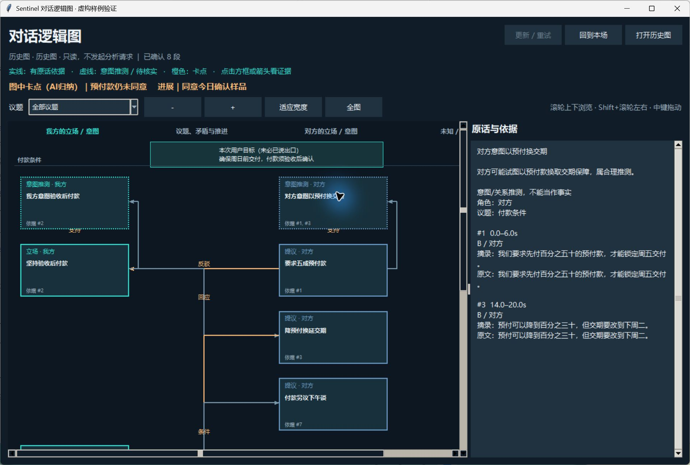

# 对话逻辑图

2026-11-13，在现有 Sentinel Windows 项目上增量加入。原 ASR、声纹、VAD、提醒分析、私人笔记和托盘保持原有入口；全局快捷键继续停用。

## 怎么用

1. 开始监听前填写本次目标，并在原说话人设置中绑定我方、对方或第三方。未绑定时，图会保留未知身份。
2. 点击主界面的「对话逻辑图 ↗」或悬浮卡片底部的「逻辑图」。首次打开后，使用现有 API 配置，在后台分析本场**已确认转写**；这会增加文本分析请求。
3. 图按议题分组、按我方 / 多方议题 / 对方 / 未知与第三方分列。方框标注议题、提议、立场、条件、意图推测、卡点、推进、已明确事项；箭头标注回应、反驳、支持、条件、推进等关系。
4. 顶部提取图中的卡点和进展。点击任意方框或箭头，右侧可查看来源片段 ID、音频起止时间、说话人、角色和逐字原文。
5. 用议题选择框聚焦一个问题；滚轮浏览、中键拖动、加减缩放，「适应宽度」与「全图」查看分支全貌。大图按每页400节点分页，所有早期节点仍可查看；跨页箭头只在两端同时显示时绘制。
6. 停止监听后仍可查看本场图。新一轮监听使用新的会话和图文件。重启应用后可点击「打开历史图」读取保存的图，历史图本身不发起 API 请求；「回到本场」返回当前对话。

收起图窗口后，本场已开启的归纳继续更新。停止监听后会归纳已收到的片段；明确退出应用时，等待麦克风收尾，保存最终图并结束图分析线程。网络请求使用原客户端25秒超时，退出期间界面保持响应。

## 事实、推测与身份

- 只有已确认语音参与逻辑归纳；临时识别和私人笔记均不参与。用户目标作为单独锚点展示，不算已经说出口的内容。
- 意图节点始终使用虚线框，明确标为推测。它可以帮助提出核对问题，不能据此断言对方有某种隐藏动机。
- 实线表示存在对应原话引用，**不保证 AI 对含义和关系的归纳正确**。重要判断请点击核对原文。
- 节点角色从引用片段的实际角色绑定计算；模型不能自行把 unknown 分给我方或对方。混合证据归为多方。
- 对方的提议、单方承诺、拒绝、沉默、条件接受与我方同意在提示协议中明确区分。
- 模型返回的片段 ID、逐字引文、节点类型和箭头端点须通过校验。无依据的补丁不覆盖现有图。
- 更正说话人或片段后，相关旧节点和箭头失效，并重新分析；若正在看该旧节点，右侧依据也清除并提示已失效。

## 实时更新与整场保留

图使用独立的后台文本分析线程，首次点击逻辑图前不新增图分析 API 请求。不会创建第二个麦克风流，也不修改原实时提醒提示词和策略。

每批最多32个待分析片段，请求之间至少间隔8秒；这是请求节流，不是8秒内必定完成的承诺。实际延迟取决于模型、网络和补齐历史的批次数。失败时保留原图，显示原因，并对失败请求退避。

本场全部已确认片段在图文档中保留，独立于主界面最近128条转写的显示上限。模型分批读取新片段和最近80个图节点及其证据；较长会话中的远距离关系可能遗漏或重复归纳，不能把图视为完整、准确的谈判事实记录。历史原话仍保留供核对。

图和审阅进度保存到：

```text
%LOCALAPPDATA%\Sentinel\logic_graphs\<会话ID>.json
%LOCALAPPDATA%\Sentinel\logic_graphs\<会话ID>.events.jsonl
```

JSON 保存原始确认文本、归属、音频时间、节点和箭头；事件日志记录请求耗时、图工作线程 CPU 时间、错误与会话 ID。不会因逻辑图保存完整原始录音。安装包资源审计已排除 `logic_graphs`。

## 本轮验证

- 数据与窗口测试覆盖超过128条的全场保留、32条分批补齐、未知身份、强制区分推测、伪造引用拦截、非法箭头、角色纠正、旧结果丢弃、保存重读、点击原话、图不变时避免整场复制、长图分页及退出时保留最后确认句。
- 原桌面生命周期测试继续覆盖开始、停止、再次开始、麦克风释放、笔记和后台错误下的界面操作。
- 用8段**虚构** A/B 谈判调用真实 DeepSeek：最终得到11个节点、10条关系，8段均已审阅。结果保留“只同意确认样品，预付款仍未同意”的区分。该次图请求耗时约9.14秒、图线程 CPU 约1.53秒；只是本机短样例，不代表长对话性能。
- 实际 Windows 窗口已检查节点点击和全图缩放。以下截图来自该虚构样例，不是本机私人对话。
- 最终 EXE / 安装包验证及文件校验值见 [构建报告](release/BUILD_REPORT.md)。



[查看整场总览截图](docs/screenshots/logic-graph-overview.png)

尚未完成长时间真人对话、语义准确率统计或多显示器混合 DPI 测试。图的归纳质量仍需用户通过原话校对。

## 文件

新增 `sentinel_logic.py`、`sentinel_logic_ui.py`、`test_logic_graph.py`；修改 `sentinel_panel.py`、`sentinel_ui.py`、`sentinel_package_test.py`、`test_desktop_features.py`、`build_exe.py` 和 `.gitignore`。依赖沿用 Tkinter 和现有 LLM SDK，无需安装 Graphviz 或浏览器组件。
