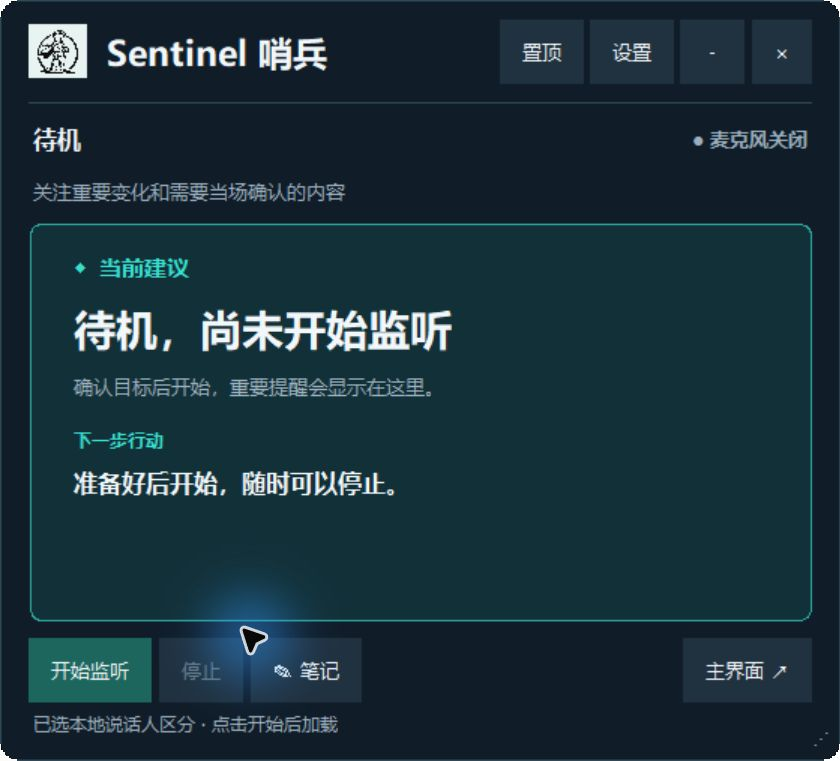
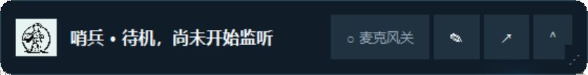
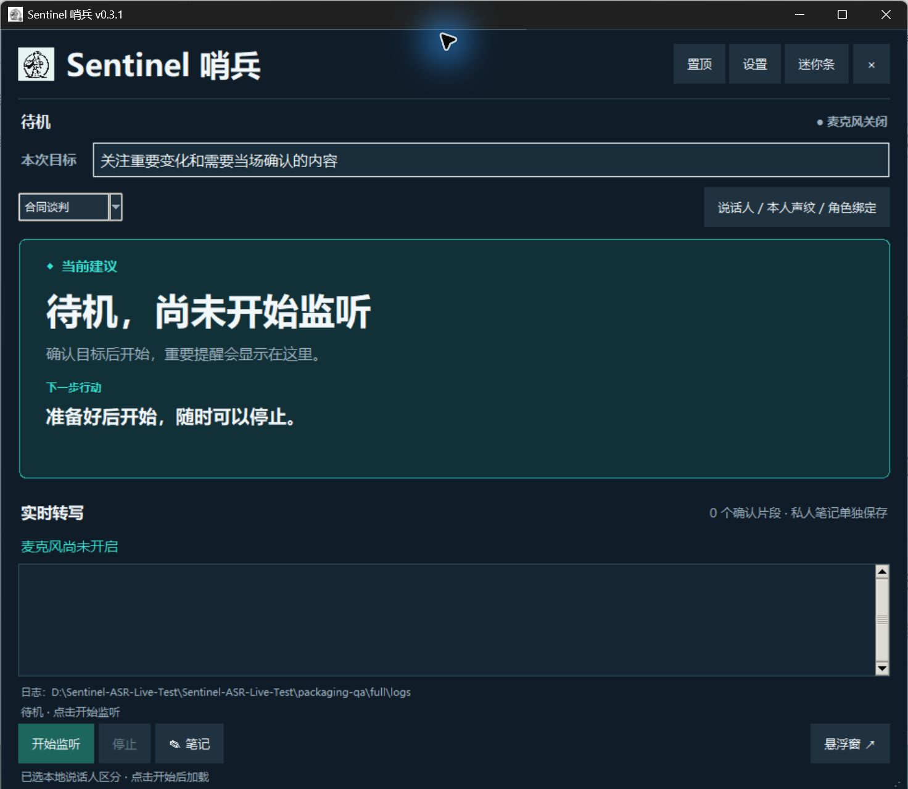

# Sentinel v0.3.1 悬浮窗升级

2026-11-06，在现有 Tkinter 项目上增强三个视图，继续连接原有 Paraformer、CAM++、VAD 和 DeepSeek。按最新需求，**已停用全局快捷键并移除快捷键设置**；旧偏好文件中的绑定字段保留，但应用不再注册它们。

## 使用方法

默认打开深色圆角悬浮卡片，显示本次目标、麦克风开关状态、当前建议、简短依据、下一步行动和说话人状态。

| 入口 | 操作 |
| --- | --- |
| 拖动标题 / 品牌区域 | 移动悬浮窗 |
| 右下角拖动标记 | 调整窗口大小 |
| 置顶按钮 | 固定 / 取消置顶，偏好继续保存到本地 |
| 标题栏「﹣」 | 折叠为单行迷你状态条 |
| 卡片「主界面 ↗」或点击目标文字 | 打开大字主界面，编辑目标、选择场景、查看转写 |
| 主界面「悬浮窗 ↗」 | 回到悬浮卡片 |
| 主界面「迷你条」 | 折叠为状态条 |
| 状态条麦克风按钮 | 开始 / 停止，文本明确显示麦克风开或关 |
| 状态条「✎」「↗」「⌃」 | 私人笔记 / 主界面 / 展开卡片 |
| 设置 | API 配置、本人声纹与角色绑定、视图切换、明确退出 |
| 关闭按钮 | 收起到托盘，监听按当前状态继续 |
| 托盘或任务栏 | 恢复窗口；托盘还可开始 / 停止、写笔记、退出 |

主界面使用更大的品牌、当前建议和行动字号，实时转写单独排列并提供滚动条。青绿色强调当前建议和麦克风开启状态，错误使用琥珀色。短句、未知说话人和角色仍取自原有后台事件。

三种视图共用已有会话控制器，切换视图不会重新开麦克风，也不会清空当前提醒、会话或转写。私人笔记继续独立保存，不自动发送给 LLM。笔记编辑器中的 Ctrl+Enter 是窗口内部保存操作，不是全局快捷键。

## 构建与测试

- 原有 Python 入口 `start_sentinel.cmd` 保留。
- 新版 EXE 和安装包继续输出到 `dist\Sentinel\Sentinel.exe`、`release\Sentinel-Setup.exe`。
- 原模型、`.env` 和历史数据保留。新数据仍位于 `%LOCALAPPDATA%\Sentinel`。
- 单元测试：71 项中 69 通过、2 项原生 opt-in 测试跳过；21 项桌面测试通过。后续修复紧凑视图首帧测量后，控件边界与紧凑尺寸回归测试再次通过。
- 新增 / 增强验证覆盖状态条开始停止与新会话、视图切换保留提醒、未知说话人、错误提示、按钮与行动文本边界、设置退出与笔记保存按钮可见、旧偏好存在时仍不注册全局快捷键。
- 打包后运行真实模型、麦克风循环、DeepSeek 固定文本连通检查、笔记读写、托盘退出与单实例恢复；具体结果、文件大小和校验值见 [构建报告](release/BUILD_REPORT.md)。

截图均来自实际运行窗口，处于待机状态：

## 修改范围

- 新增 `sentinel_ui.py`：三个视图、配色、圆角与任务栏可恢复性。
- 修改 `sentinel_panel.py`：视图切换、拖动缩放、内容尺寸适配、设置页及无全局绑定启动。
- 修改 `sentinel_notes_ui.py`：配色、浮层顺序和保存区域布局。
- 修改 `sentinel_windows.py`：默认空的全局绑定；托盘与单实例机制保留。
- 修改 `sentinel_package_test.py`、`test_desktop_features.py`、`test_packaging.py`：UI、零热键注册、边界及编码回归验证。
- 更新 `README.md`、`PACKAGING.md`、`DESKTOP_V031.md`、构建报告与截图。

圆角和任务栏样式使用 Windows 原生窗口接口：[SetWindowRgn](https://learn.microsoft.com/en-us/windows/win32/api/winuser/nf-winuser-setwindowrgn)、[扩展窗口样式](https://learn.microsoft.com/en-us/windows/win32/winmsg/extended-window-styles)。不增加图像或 UI 框架依赖。

本轮未重测三分钟真人声纹准确率、长时间监听、多显示器混合 DPI 或 Windows 10；保留前一轮的验证边界。界面采用实体深色背景，未实现参考图中的毛玻璃背景效果。
