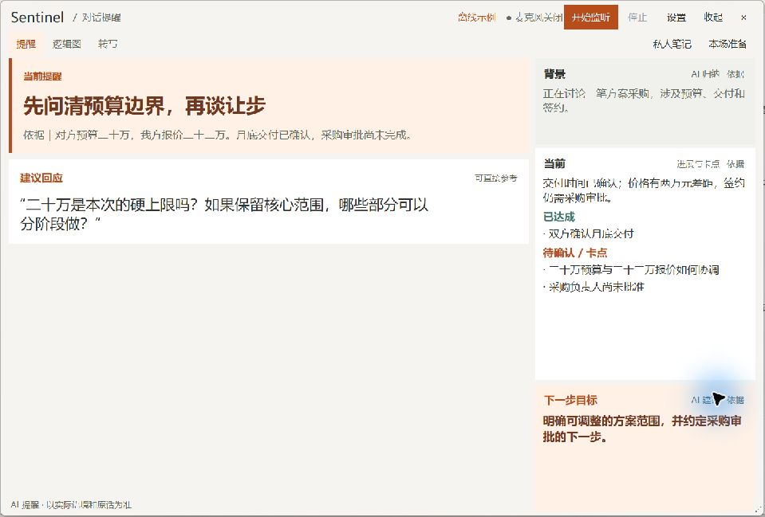
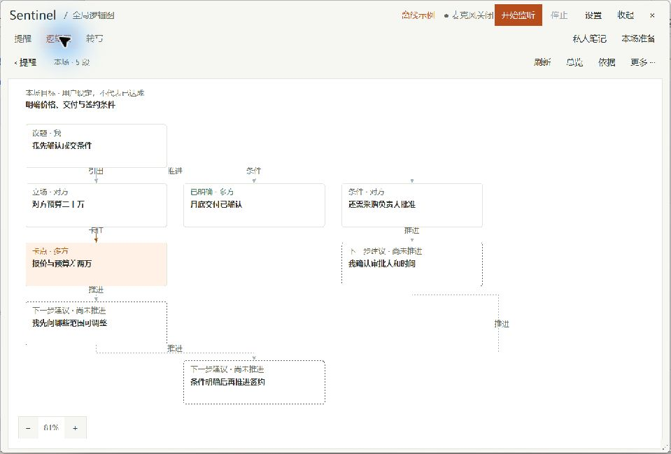

# Sentinel 对话界面 · 当前源码

更新日期：2026-11-19。此文描述工作区源码，现有 Release 与安装包尚未重建。

## 信息与交互

默认进入提醒主页。左侧以「此刻值得留意 → 依据摘要 → 可以这样回应」为主，右侧固定一列「背景、当前、下一步目标」。当前包含已达成、待确认与卡点；正文常显，完整引文才进入同窗依据页。三段上下文各有独立空间，长内容不会把下一步目标挤出窗口。

背景和目标必须有已确认原话引文，缺失时显示等待，不编造情境。下一步目标标为 AI 建议，表示希望推进的结果；具体回应在主区。共识和引文仍需人工核对语义：存在逐字来源不等于模型理解正确，单方提议不能当成双方达成。

顶部保留真实麦克风状态及开始/停止监听；导航为提醒、逻辑图、转写和会议悬浮。目标、场景、声纹、知识库集中在「本场准备」。私人笔记、设置、API、声纹、知识库、原话与逻辑图均在同一窗口切换。系统文件选择器仍用于选择目录和历史图。

桌宠及气泡已移除。关闭或收起窗口后从系统托盘恢复，监听继续。没有托盘则最小化到任务栏。新提醒只更新正文与未读标记，不弹出窗口、抢焦点或自动开始监听；回到提醒主页清除未读。托盘服务故障也只保留任务栏入口。默认不置顶，手动置顶选项在设置中。

新提醒将主区滚回顶部，避免标题停留在旧滚动位置以外。此前提醒最多保留两条标题，标为「此前提醒」，不暗示仍未解决。新会话、原文或角色更正清空旧提醒与归纳；更正前在途结果由 source_epoch 拦截。

私人笔记不发给模型。离页、隐藏前先保存草稿；写入失败取消操作，保留编辑内容。转写和各工具切换共用同一个会话，不重新加载音频或创建第二个监听线程。

## 一张全局逻辑图

图是独立视图，不取代提醒主页。从上到下显示事情推进，横向展开同时进行的事项，允许条件分叉与跨事项汇合。按实际对话组织价格、范围、交付、审批等分支，不机械补齐没有提过的事情。没有角色泳道、议题过滤或分页，长会话仍保留所有节点。

卡点以橙色区分，下一步建议使用虚线并明确标注建议；建议节点强制 inferred。循环与回指关系保留来源，但不作为已经完成的步骤。只有用户打开过逻辑图后才启用图分析，不在默认主页隐式增加图请求。

主页面逻辑图的节点高度从144缩至76、层距从184缩至104，删除重复正文和底部冗余编号。总览同时考虑窗口宽高，最多100%，避免把稀疏图自动放大；最低80%保留可读性，长图仍滚动查看。标题10pt、摘要9pt，以简短措辞突出内容。

支持拖动空白平移、滚轮纵向浏览、Shift+滚轮横向浏览、Ctrl+滚轮或按钮缩放。点击节点或连线显示画布内依据抽屉，可收回；依据不是新的原生窗口。历史图保持只读。

## 视觉与运行边界

暖白、橙色、细边框，减少大面积粗体和次要控件。共享滚动滑块没有箭头和粗轨道，内容不溢出时隐藏；输入控件保留原生滚轮行为。

完整阅读与编辑页面保持不透明。会议浮窗默认是 600×58 逻辑像素的横条（玻璃条本身高 42，其余为透明阴影边距）：真实麦克风状态、监听时长、当前提醒与七个图标。没有 logo、产品名、人物、视频背景或桌宠。提醒过长时单行截断，悬停显示全文，点击提醒在本窗下方展开完整提醒和背景。

转录、背景和逻辑图均在横条下方原位展开；再次点击当前图标收起。提醒 / 转录默认 600×300，逻辑图默认 760×440，分别记住本次运行中的调整尺寸，均限制在可用屏幕内。图收起后的横条恢复紧凑宽度。转录左侧用小号灰色时间 / 角色和正文分层显示确认原话，右侧以连续文字常显背景、当前（已达成 / 待推进）、下一步目标。右栏只有一个外层滚动区，各段按内容自然增高；原话依据加入同一内容流。逻辑图仍是一张允许分支与汇合的全局图，节点和关系可点击查看内嵌依据，状态 / 失败提示及重试直接可见。

会议逻辑图默认按 100% 原字号从顶部阅读，节点标题 11pt、类别 9pt，较暗的类别文字便于扫读；按实际窗口宽度排 1–4 列。工具栏提供完整全图、1:1、缩小、放大与当前比例，双击节点回到原字号聚焦。完整全图允许低于 80%，保证全部分支在画面内；长图总览用于看结构，细节需切回原字号。相机使用控件所有的单次定时器，等堆叠页面 / 窗口 / 滚动条布局完成后更新，修复隐藏小视口计算缩放和图头裁切。新文档从顶部开始，同一文档新增内容保留用户的手动缩放。

会议渲染使用 PySide6-Essentials 6.10.3。顶部条与展开面板分为两块圆角玻璃，中间留出 18px 间隔；它们仍属于同一个原生窗口，圆角 mask 使间隙透出桌面。`assets/meeting-glass/toolbar.png`、`panel.png` 已换为用户提供的中性白空白生图，完整移除此前裁图中的黄绿景色。收到的素材是白底 JPG，因此提取脚本做中性灰度化、圆角 Alpha 与边缘高光的近似重建，不能声称恢复了原始透明度。PNG 主体 Alpha 为 86，所有档位都保留素材自身透明度，不再有完整静态覆盖。48px 源角区九宫格伸缩保留边缘，QImage 缓存读取；缺图回退矢量材质。图卡仍使用矢量玻璃与依据虚线。原生层优先白色 acrylic（accent 4），失败后普通 blur（accent 3）。文字和图标保持完整不透明度，没有全窗淡化、透明色键或辅助合成窗。Pillow/numpy 只用于开发提取，不新增运行时依赖。

主页面与原有工具仍使用 Tk，`SentinelPanel` 和 `SessionController` 是唯一会话所有者。会议模式隐藏 Tk 窗口，只显示一个 Qt 窗口；返回主页时隐藏 Qt，恢复同一个 Tk 工作区。Tk 的 16ms 定时器在同一 UI 线程处理 Qt 事件。Qt 的原生按钮、菜单和关闭动作先入队，再由 Tk 定时器执行，禁止从 Qt 原生回调重入 Tcl；这修复了真实鼠标展开时的 GIL 崩溃。动作异常也保证后续定时器继续调度，销毁清空待执行动作。不启动第二个事件主循环、监听线程或分析服务。退出时取消定时器并销毁 Qt 窗口。监听计时由控制器记录，即使隐藏期间开始监听，恢复后时长也正确。

图标支持悬停说明、键盘与拖出取消。更多菜单只改变玻璃白色涂层浓度与手动置顶，不降低文字透明度。默认不置顶；提醒、错误和图更新不自动显示或激活窗口。隐藏后监听继续；没有托盘时最小化 Qt 到任务栏，托盘失效也不会弹出主页面。更正和新会话清空失效依据；新提醒归顶，同一内容刷新保持滚动位置。

最终回归记录见下方；固定示例不连接音频或模型。安装包尚未重建，新依赖尚未补入旧版离线 wheel 附件。

主页强化视觉层次：当前提醒用浅橙底、橙色竖线及加粗标题突出；建议回应置于独立白卡，字号高于辅助依据。右侧背景用灰底弱化，下一步目标用浅橙底和深色粗体强调，已达成与卡点的小标题分别使用绿、橙色。颜色用于区分信息用途，不推断风险级别或已完成状态。

背景使用紧凑高度，右侧优先把空间留给当前进展和卡点。建议回应控制行宽，长内容仍在原滚动区。此批48项桌面/生命周期测试通过，最后排版调整的3项窗口回归通过，日志 `.downloads/ui-emphasis-tests.txt`。独立只读复核未发现新增问题。

逻辑图可读性调整通过 48 项桌面回归（`.downloads/graph-camera-regression.txt`）及最后 2 项图相机 / 依据回归（`.downloads/graph-camera-doubleclick-tests.txt`）。黑盒检查顶部卡片可见、原字号、全图全部节点进入视野、新增对话后保留手动缩放、图 / 转录各自尺寸，以及首击打开依据改变几何后双击仍定位同一个节点。独立只读复核无阻塞问题。实际鼠标检查阅读与总览，固定示例总览约 67%，长图仍需放大或滚动阅读。

紧凑调整（2026-11-19）：玻璃条高 42、间隔 14、图标 26×28；会议图卡宽 208、高 76、列距 232、行距 96，标题 11pt 与类别 9pt 保持。共享布局继续保存逻辑坐标，仅 Qt 展示层投影至紧凑网格；三列分支可在较窄图窗中展示。关系标签减少文档边距，避免 20px 行间空隙裁字。48 项桌面回归通过（`.downloads/compact-overlay-tests.txt`），最后 3 项相机 / 依据 / 尺寸切换复核通过（`.downloads/compact-overlay-final-tests.txt`）。

## 知识库与声纹

本场准备中的可拆卸知识库支持登记本地目录、多选、取消和移除。移除只删登记，不删文档。损坏的目录选择文件保留并阻止覆盖。**当前只保存选择元数据，不扫描、索引、检索或把文档加入分析**；页面明确显示检索待接入。

已有本地 CAM++ / VAD 说话人区分、本人声纹录入/重录/删除、匿名 ID 与角色绑定。需启用相应设置并具备模型；本人录入需明确同意保存特征。未知和重叠说话不能可靠归属时仍显示未知。详见 [SPEAKERS_GUIDE.md](SPEAKERS_GUIDE.md)。本轮未进行真人准确率复测。

## 验证与维护入口

使用隔离数据、假音频和假 API 运行回归，日志 `.downloads/conversation-ui-tests.txt`。独立代码审查发现的新提醒滚动位置、原话入口、转写导航、任务栏恢复标记与服务故障抢焦点问题已修复，并补充黑盒交互测试。

玻璃参考调整通过 `test_desktop_features` 的 47 项回归（`.downloads/glass-reference-tests.txt`），并经独立只读审查和实际鼠标展开检查。原话更正 / 新会话的依据失效、输入排队、隐藏和关闭逻辑保持通过。转录 HTML 对正文和角色转义，禁用链接；右栏明确使用纯文本。此前完整回归 167 项：165 通过、2 项可选原生测试跳过，记录 `.downloads/compact-glass-full-tests.txt`。固定示例不连接音频或模型。

最后的选中态与阴影边界微调另通过 3 项展开 / 尺寸 / 键盘回归（`.downloads/glass-reference-final-tests.txt`）。中性白新素材通过 3 项材质 / 展开 / 回退回归，另核对 PNG 灰度、半透明主体与透明四角，经独立只读审查并重新检查实际鼠标展开。实际窗口验收使用固定销售示例，不连接音频与模型。未重建安装包，未做真实麦克风、付费 API、真人声纹准确率、多显示器混合 DPI 或 Windows 10 验收。旧截图不作为当前源码界面依据。

| 模块 | 职责 |
| --- | --- |
| `sentinel_ui.py` | 提醒、常显上下文、准备和转写布局 |
| `sentinel_overlay_ui.py` | Tk / Qt 事件桥接及窗口释放 |
| `sentinel_meeting_window.py` / `sentinel_meeting_icons.py` | 白色磨砂横条、矢量图标及原位展开 |
| `sentinel_meeting_content.py` / `sentinel_meeting_graph.py` | 转录、背景与当前会话逻辑图；复用共享数据 |
| `sentinel_meeting_material.py` | 横条、展开面板和图卡共用的玻璃填充、高光与外阴影 |
| `sentinel_glass.py` | Qt HWND 上的白色 Acrylic 与普通模糊回退 |
| `sentinel_panel.py` | 会话与窗口生命周期、事件消费、工具入口 |
| `sentinel_workspace.py` | 同窗工具导航、草稿保存与焦点释放 |
| `sentinel_briefing.py` | 纯摘要模型、确认引文、更正失效 |
| `sentinel_graph_layout.py` | 纯图布局、分层、分叉与循环处理 |
| `sentinel_logic_ui.py` | 图渲染、缩放平移、依据与历史 |
| `sentinel_scroll.py` | 细滚动滑块、局部滚轮路由 |
| `sentinel_knowledge.py` / `sentinel_knowledge_ui.py` | 知识库选择元数据及界面 |

架构边界见 [ARCHITECTURE.md](ARCHITECTURE.md)，开发环境见 [DEVELOPMENT.md](DEVELOPMENT.md)。
